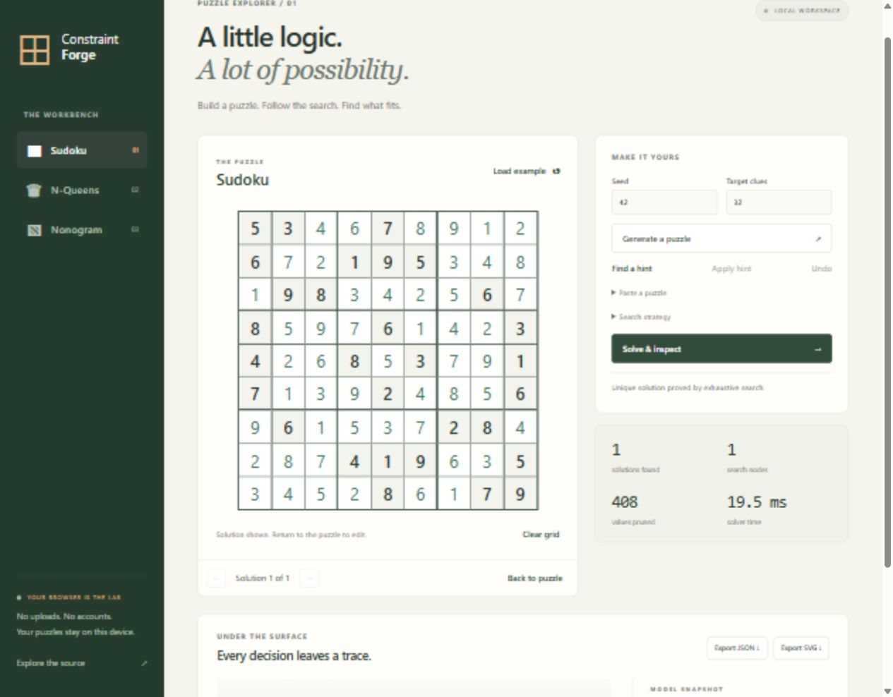

# Constraint Forge

[](https://github.com/VictorOdoyo/constraint-forge/actions/workflows/ci.yml)

A constraint programming and puzzle research toolkit with no runtime dependencies.
Requires Node.js 22 or later. MIT licensed.

## Interactive explorer

```sh
npm run explore
```

Open [the local workbench](http://127.0.0.1:4173). Edit or generate a Sudoku,
enumerate Queens placements, or enter Nonogram clues. Inspect search decisions,
compare strategies, browse solutions, and export results. All solving runs in
browser workers; Stop terminates a job immediately. No account or server-side
puzzle storage is used. A different port can be passed as `npm run explore -- 4300`.



## Quick start

```sh
git clone https://github.com/VictorOdoyo/constraint-forge.git
cd constraint-forge
npm test
node src/cli.js queens 8
node src/cli.js generate 42 32
npm run bench
npm run bench:validate
npm run examples
node bench/compare.js 3
```

Running the solver and tests needs no dependency installation. Install development
tools with npm ci when changing code or running the formatter.

## Capabilities

- Reversible domain trails, compiled topology, support residues, MRV, dom-wdeg,
  and least-constraining value ordering.
- Global allDifferent using bipartite matching, table filtering, exact integer
  sum and weighted-linear propagation, DFA reachability, and scheduling timetables.
- Count-only enumeration, search traces, validation, unsatisfiable cores,
  topology inspection, and independent component solving.
- Incumbent, lexicographic, Pareto, and linear branch-and-bound optimization.
- Worker threads, live cancellation, hard worker wall budgets, bounded batches,
  and portable models that contain data rather than executable predicates.
- Sudoku and N-Queens plus Nonograms, KenKen, Kakuro, Futoshiki, Latin squares,
  magic squares, alphametics, crossword filling, coloring, packing, and scheduling.
- Independent Algorithm X solver, Sudoku uniqueness and generation, human-style
  deductions, clue minimization, and SVG puzzle exports.

## Example

```js
import { Model, Solver, minimizeLinear, solveAsync } from './src/index.js';

const model = new Model()
  .variable('alice', [1, 2, 3])
  .variable('bob', [1, 2, 3])
  .constrain(['alice', 'bob'], (a, b) => a < b, 'ordering');

console.log(new Solver(model).solve({ valueOrder: 'lcv' }).solutions);
console.log(minimizeLinear(model, { alice: 2, bob: 1 }).best);
console.log(await solveAsync(model, { wallTimeoutMs: 2000 }));
```

## Correctness and limitations

Complete means exhaustive search. Limit and interrupted results never prove
uniqueness, infeasibility, or optimality. The test suite checks known counts,
independent brute-force oracles, alternative Sudoku algorithms, cancellation,
precision boundaries, and public command-line workflows. CI covers Windows and
Linux on Node 22 and 24.

Generic n-ary predicates can be expensive. Global matching is a straightforward
augmenting-path implementation, not Regin filtering. Linear branch and bound
requires safe integers; general linear predicates use JS Number semantics.
Synchronous cancellation is cooperative; use workers for timer-driven aborts.
Sudoku effort metrics are diagnostic rather than calibrated human ratings.

Read the [API reference](docs/api.md) for input formats and result contracts,
[architecture notes](docs/architecture.md) for algorithms and practical limits,
and [release verification](docs/release.md) for completed scope and evidence.
The [performance report](docs/performance.md) explains the reproducible benchmark corpus.
Commit history records individual features, verification, and fixes.
